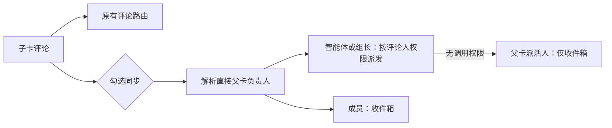

# CLAWSTA-151「等我处理」清单

负责人：前端负责人（方案与前端验收）；后端架构师（B 节契约确认与后端验收）。

## R4：按「谁派活谁验收」重做（2026-11-07 Tane 确认）

v0.2.17 上线后发现：智能体把执行子卡也挂成「等你」，清单里混进不该 Tane 管的卡；需要 Tane 回答或动手的卡（阻塞）却进不来。本节取代 A1–A5、B1 中与下列规则冲突的部分；未提到的（入口、行布局、等待时长配色、5 秒撤销、打回接收人预览、看板标签）保留。

### R4.0 规则

1. **派活的人**：人亲手建的卡 = 建卡成员；在新建窗口「交给智能体创建」的卡（`origin_type = quick_create`）= 提交请求的成员；智能体干活时自建的卡（`origin_type = agent_create`）= 无。
2. **「等你」只挂在有派活人的卡上**，默认等派活的人；可以明确改成另一位成员（顺序签：张三通过后负责人再挂等李四），一张卡同一时间只等一个人，不做会签。无派活人的卡拒绝挂「等你」；`specialist` 不受此限。
3. **三类**：
   - 审批 = `in_review` + `review_kind = approve`，按钮「通过 / 打回」。
   - 回复 = `blocked` + `review_kind = reply`，需要派活人回答问题，按钮「回复」。
   - 推进 = `blocked` + `review_kind = act`，需要派活人在系统外动手（装机、授权、给材料），按钮「已完成」。
   - 「回复 / 已完成」= 弹出层填一句话 → 发顶层评论（交回负责人）→ `in_progress`，复用 R2 的打回链路与接收人确认。
4. **负责人**：推进卡的人，可以是智能体、小组或成员，但不能是这张卡的审批人。负责人是成员时，打回 / 回复 / 同步进其收件箱，不启动运行。
5. **交接处换卡**：别人派给我的卡，不直接转给我的智能体（后续系统叫醒按派活人的权限算，会被拒）。改负责人为智能体且派活人无权叫醒它时，提示「{派活人} 无法叫醒它」，给按钮「建一张我的子卡交给它」：以当前成员身份在本卡下建子卡（标题、描述沿用，负责人为所选智能体），本卡负责人不变。
6. **子卡评论同步**：子卡（有父卡）的新评论框和线程回复框加开关「同步给主卡负责人 · {名字}」，默认不勾、发送后复位；回复主卡负责人自己的评论时锁定为勾选；编辑评论、主卡本身、主卡负责人就是子卡负责人、评论人就是主卡负责人时不显示。勾选后正常路由不变（子卡负责人照常接手），另外把这条评论交给主卡负责人。主卡负责人看完可以静默结束，时间线留一行「已阅：无需调整（原因）」。评论人无权叫醒主卡负责人时，开关文字改为「同步给 {主卡派活人}」，只进收件箱。
7. **两个入口**：收件箱照旧收所有动态，子卡的通知行加一行灰字「属于 CLAWSTA-x · 主卡标题」；「等我处理」只列等我的卡，按 回复、推进、审批 分组，组内等得最久的在前；底部一行「另有 N 张卡在等人，但没标明等谁」，只统计派活人是我、状态为 `in_review` / `blocked` 且没挂标签的卡，点开为筛好的列表。
8. **补充场景**：
   - 派活人直接在卡里评论回答，等同点「回复」：负责人被叫醒后把卡改回 `in_progress`，标签随状态变化清掉，卡自动离开清单。
   - 派活人离开工作区：卡不再算等他，改计入工作区所有者 / 管理员的「未标明」提示。
   - 状态离开 `in_review` / `blocked` 一律清四键（含 `review_kind`），从 `blocked` 直接到 `in_review` 也清，由负责人按新状态重挂。

### R4.1 后端（后端架构师先评估，确认后写入 B 节作为实现契约）

1. `review_kind`：`approve | reply | act`；`in_review` 缺省为 `approve`，`blocked` 必填且只能是 `reply | act`；`blocked` 只接受 `review_by = user`。并入 `prepareReviewMetadata` / `validateReviewValue`、B4 原子写入口与撤销快照。
2. `errReviewClosed` 放宽到 `in_review | blocked`；584 的状态触发器清键条件改为「旧状态是 `in_review` 或 `blocked` 且状态变化」，清键列表加 `review_kind`。新迁移，不改 584。
3. 派活的人：服务端解析（成员建卡 → `creator_id`；`quick_create` → 来源任务的请求成员；`agent_create` 及其他无人来源 → 无），在 issue 输出里给只读字段（建议 `dispatcher_user_id`），列表支持按它筛选。写 `review_by = user` 时：无派活人 → 400；缺 `review_user` → 填派活人；显式 `review_user` 照旧校验成员。
4. 清单查询：一次取回 `status ∈ {in_review, blocked}` 且 `review_by = user` 的卡（多状态筛选或等价接口），口径同 B2。「未标明」计数：`dispatcher_user_id = me`、状态同上、无 `review_by`。
5. 同步开关：评论创建增加可选字段（建议 `sync_parent_assignee: true`），不走显式 @（显式 @ 会压掉子卡负责人兜底）。服务端对父卡负责人按评论人权限走 `canInvokeAgent`；通过则叫醒，否则给父卡派活人发收件箱通知。触发预览接受同一字段并返回将要叫醒的对象或降级对象，前端用它决定开关文字。
6. 「已阅」静默出口：把 `squad activity no_action` 推广到普通负责人（被同步叫醒的主卡负责人可用），时间线显示「已阅：无需调整（原因）」，不发评论。命令形式由后端定。
7. 转派预检：给前端一个判定「派活人能否叫醒某智能体」的读接口（或并入现有指派校验的预检），用于 R4.0-5 的提示。
8. 收件箱项：子卡通知需要父卡编号和标题；能从现有 issue 查询拿到就不改，否则在收件箱项补 `parent_issue_id`。
9. 智能体运行说明（`runtime_config_sections.go` + 内置 `multica-platform/references/issues.md`）：何时用审批 / 回复 / 推进；自建子卡不挂「等你」；`review_user` 缺省由服务端填；阻塞写 `review_kind`；被同步叫醒且无需调整时用「已阅」出口。

### R4.2 前端（前端负责人实现）

清单页三组与「回复 / 已完成」弹出层、「未标明」提示、同步开关（含锁定、隐藏和无权限降级）、收件箱父卡灰字行、转派提示与一键建子卡、看板标签在 `blocked` 列同样显示（文字「等你回复」「等你推进」）。`isAwaitingMe` 改为 `status ∈ {in_review, blocked}`。五种语言同步。

### R4.3 验收

- 后端：上述规则的 Go 测试矩阵（三种来源的派活人、`agent_create` 拒绝、`review_user` 缺省填充、`blocked` 写入与清键、同步开关的权限通过 / 降级、「已阅」时间线）。
- 前端：判定与分组的 helper 测试；开关的显示 / 锁定 / 隐藏 / 降级接线测试；亮暗两套真实渲染截图（三组清单、两种弹出层、同步开关两种文字、转派提示、收件箱父卡行）。
- 测试按 C1 分档。合并、发布另行授权。

## R1 投递

- 执行：高级开发执行专家；分支 `agent/CLAWSTA-151-awaiting`，base `89cb14411`（main，v0.2.16）。
- 范围：A 节前端全部 + B 节后端全部 + C 节测试与真实数据演示截图。发版不在 R1，验收通过后单独投递。
- 回收：推到同一分支并开 PR（base `main`，不合并），在 CLAWSTA-151 回复 base..head、测试命令与结果、截图附件，@ 前端负责人。前端验收看真实渲染截图，后端验收由后端架构师按 B6 做。
- 版本号：R1 不改版本号，发版批次再升。

## R3 投递：v0.2.17 发布（P1）与真实数据演示

- 执行：高级开发执行专家。前提：R2 前端、后端复审均通过，未关闭阻塞为 0。授权依据：issue 交付要求「实现后按版本规则走完整发布，升版本号」。
- 测试按 C1 执行：发版前只对新代码跑一次前端和 Go 全量，对照 `evidence/clawsta-151/r2/` 中的 v0.2.16 清单，不再跑 v0.2.16。全量结果更新为 v0.2.17 的基线清单。
- 推送、合并、发布只做下面列出的动作，不夹带其他改动。凭据只从本机用户环境变量读取，不得出现在命令参数、日志、评论或截图里。

### 1. 升版本号并合入

- 在 PR #48 原分支追加一个提交：`package.json`、`apps/web/package.json`、`apps/desktop/package.json` 改为 `0.2.17`。测试夹具和演示数据里提到的 v0.2.16 是数据，不改。
- 用 merge commit 合入 main，保留历史（与 #47 相同），并确认合入后的 main 与 PR head 树一致。
- 在合入后的 main 提交上打 tag `v0.2.17`，并推送 tag。

### 2. 构建与发布

- 用干净检出的 `v0.2.17` 源码，按 `docs/windows-oss-releases.md` 的「家里差量发布」，以 v0.2.16 原始未安装整包为基线，构建差量包 `v0.2.16 → v0.2.17`。使用新的输出目录，不复用载荷，不加 Force。
- 发布四个对象：`releases/v0.2.17/` 下的 `upgrade.zip`、`client-kit.zip`、`UPGRADE.md`、`release.json`。`release.json` 记录 tag 和提交。
- 上传后校验 SHA-256 和 OSS CRC64，并用 Fetch 真实下载两个包、解压核对清单。全部通过后，最后一步才切换 `channels/stable/latest.json`，并读回确认。
- 任何一步失败，都不覆盖、不删除已上传的对象。改用新版本号，并在回复里说明。

### 3. 隔离升级验证

- 在隔离目录用 v0.2.16 原包重建基线，再用官方 `Apply-Upgrade.ps1` 升级到 v0.2.17。
- 核对：程序清单和删除项；样本数据保留；迁移 584 已执行，`status_changed_at` 已回填；服务正常启动，版本显示 v0.2.17。

### 4. 真实数据演示（Tane 验收用）

- 用第 3 步升好的 v0.2.17 隔离实例，按 C 节导入当前真实的待审核卡并打标：143、149 为 `user`，148 为 `specialist`，其余不打标。导入前重新读取当前看板，用实际数量，不照抄 23。
- 截图，亮色和暗色各一套：
  - 侧栏「等我处理」的数量
  - 清单页按等待时间排序
  - 看板待审核列的三种外观
  - 打回弹出层，以及通过后的 toast
  - 另加 1280 宽和 1024 宽清单页各一张
- 截图只用于演示，不写进真实看板数据。

### 5. 落地记录与回收

- 按版本规则第 5 条新开发布落地任务，标题为「v0.2.17 发布落地（CLAWSTA-151）」。在里面写：版本、tag、提交、起止版本、对象 SHA-256、stable 切换时间。
- 台式机 `D:/UWorkers/Portable` 现场升级和移动机自动补升属于 P2，后端验收 P1 证据之后，在落地任务里另行投递。本批不动现场安装。
- 在 CLAWSTA-151 回复并 @ 前端负责人，内容包括：
  - 合并提交、tag、四个对象的 SHA-256
  - 全量测试结果及与清单的对照
  - 隔离升级结果
  - 演示截图（作为附件）
  - 落地任务链接
- 证据放在 `evidence/clawsta-151/r3/`。证据提交在合入之前追加到 PR 分支；如果合入后才产生，就跟着落地任务走，不再改 main。

## R2 投递（R1 验收后的集中修复）

- 执行：高级开发执行专家；同一分支、同一 PR #48，在 `d39ba230e` 之上追加提交，不改写历史。版本号不改。
- 来源：前端验收通过（2 处小瑕疵）；后端 B6 需要修改（1 处打回契约）+ C 节全量测试未收口。
- 回收：在 CLAWSTA-151 回复 `d39ba230e..head`、各项结果与证据路径，@ 前端负责人。后端架构师只复审本批新增差异和下面第 1、3 项。

### 1. 打回必须确认意见真的交回负责人（阻塞，B4）

`sendReviewFeedback` 现在补 @ 后不看第二次预览结果。`/note 请修复编译错误` 两次预览都是 0 个接收人，评论照发，状态照改成 `in_progress`，结果没人接手。

- 以**最终要发送的内容**做的那次预览为准：负责人是智能体时，预览里必须有该智能体；是小组时，必须有 `source` 为 `issue_assignee` 或 `mention_squad_leader` 的条目（后者须来自补的那个小组 @）。负责人是成员时不做此检查。
- 预览执行对象增加可选 `squad_id`，取自本次实际路由的小组；`mention_squad_leader` 必须同时匹配这个 id，不能仅凭同一个负责人或来源字符串认定小组已收到。普通智能体响应省略此字段；旧服务端缺此字段时，仍可确认 `issue_assignee` 兜底，但不猜测小组 @ 的归属。
- 最终预览仍不包含负责人：**不发评论、不改状态**，弹出层保留已填意见，在弹出层内显示原因。文案：
  - 意见以 `/note` 开头：「以 /note 开头的意见只做记录，不会交给 {{name}}」
  - 其他情况：「这条意见到不了 {{name}}，打回没有完成」
- 预览请求失败照旧报错，不发评论。不绕过 note、权限或运行时限制。
- 保留「评论已成功、只重试状态」的行为。
- 测试（`packages/core` 的 helper 测试负责判定矩阵，views 测试只验接线）：普通意见、显式 @ 别人导致兜底被抑制后补 @ 成功、`/note`、补 @ 后最终预览仍为空、评论成功状态失败只重试状态。

### 2. 前端两处小瑕疵

- 清单行第二行：标题去掉固定的 `max-w-[260px]`，改为可收缩截断（`min-w-0` + `truncate`，按需 `flex-1`/`basis`），让「·」紧跟省略号；1024 宽下编号、负责人、已等时间不被挤掉。
- 打回弹出层：去掉与按钮同名的可见标题「打回」，输入框保留可访问名称「打回意见」（`aria-label`），占位提示仍是「说一下哪里要改」。五种语言同步。

### 3. C 节全量测试收口

C 节要求 `pnpm typecheck`、`pnpm lint`、`pnpm test` 和后端全量测试通过。本机没有 `make`，后端用等价命令（`cd server && go test ./...`，按 Makefile 的 `test` 目标补齐环境）。

- 在 head 和 base `89cb14411`（v0.2.16 已发布提交）上用同样的命令、同一台机器、同一隔离数据库各跑一遍全量，失败清单逐条对比。
- **head 不允许有 base 没有的失败。** 新出现的失败一律修。
- base 上就有的失败：逐条写一句原因（Windows 环境、测试自身缺陷、偶发），能在测试设施层面小改修好的就修（例如 desktop `scripts/package.test.mjs` 的语法错误若是测试文件或 Node 版本问题）；涉及产品行为的不在本批改，列入清单交回。
- 偶发失败：单独重跑 3 次，记录结果。
- 证据：两份完整输出放 `evidence/clawsta-151/r2/`，另附一张对比表（失败项 / base / head / 原因 / 处理）。

### 4. 截图

只补本批改动处的真实渲染：清单页 1024 亮色一张（看第二行）、打回弹出层亮暗各一张、`/note` 失败提示一张。

## 本批目标（R1）

用户打开 UWorkers 就能看到「等我处理」的清单：只列需要他本人动手的待审核任务，每张一句话说清要做什么，等得最久的排最前，可以直接通过或打回。看板卡片上分清「等你」和「等验收」。

## A. 前端方案（已定）

### A1 入口

- 侧栏个人区 `收件箱` 下方新增一项 **等我处理**，右侧数量沿用收件箱的 `CappedNumberFlow` 样式；数量为 0 时不显示数字。
- 路由 `/<workspace>/awaiting`（web 与 desktop 都接入，图标在 `routeIconForPath` 里登记为 lucide `UserCheck`）。
- 英文 `Waiting on you`，中文 `等我处理`；其余语言先用英文。

### A2 清单页

单列、居中、最大宽度与收件箱一致。每行：

```
[要你做什么的那句话 —— 主文字，text-body font-medium，最多两行]
CLAWSTA-143 · 运行超时界面化…（标题，单行截断） · [头像] 交付方 · 已等 2 天        [打回] [通过]
```

- 主文字是**动作句**，不是标题。标题、编号、交付方、等待时长都放在第二行的次要文字里（`text-caption text-muted-foreground`）。
- 等待时长：`已等 X 分钟/小时/天`，复用现有 `useTimeAgo` 的口径；超过 3 天用现有警示色 token。
- 没写动作句：主文字位置显示「交付方没写要你做什么」（muted），行仍可点开。
- 点行本身打开现有 issue peek；按钮点击不冒泡。
- 排序：`status_changed_at` 升序（等得最久在前）；该字段缺失时退回 `updated_at`。
- 空状态：一个对勾图标 + 「没有等你处理的事」，不加说明文字。
- 键盘：行可 Tab 聚焦、Enter 打开；两个按钮可达，焦点环用现有样式。

### A3 通过 / 打回

- **通过**：`status → done`，不弹确认框；出现 toast「已通过 CLAWSTA-143」带「撤销」（5 秒），撤销按 B4 用 `review_metadata` 原子恢复 `in_review` 和原四键；409 时提示「任务已有变化」并刷新。行在服务端成功后移出（不做乐观删除）。
- **打回**：按钮展开 Popover，一个必填文本框（占位「说一下哪里要改」）和「打回」按钮。提交顺序：先发顶层评论（作者为当前用户，由现有成员评论接手机制交回负责人），再 `status → in_progress`。评论成功而状态失败时显示「意见已发送，状态未更新」，重试只重试状态（细则见 B4）。评论失败时保留输入并提示重试。

### A4 看板卡片与列表行

只在 `issue.status === "in_review"` 时显示：

- `review_by = user` 且是给当前用户的：小标签 **等你**（实心、主题强调色的浅底，`text-micro`），标题下加一行动作句（单行截断，`text-caption text-foreground`）。
- `review_by = user` 但给的是别人：标签 `等 <成员名>`，muted，不显示动作句。
- `review_by = specialist`：标签 **等验收**（描边、muted），悬停提示 `等 <智能体名> 验收`（有 `review_agent` 时）。
- 没有 review 元数据：保持现状，不加任何东西。
- 卡片现有布局、宽度、截断规则不改（B2 已回退的自适应列宽不得带回）。

### A5 「等你」的判定（前端纯函数，放 `packages/core/issues/`）

```
isAwaitingMe(issue, meUserId) =
  issue.status == "in_review"
  && metadata.review_by == "user"
  && (metadata.review_user 缺失 || metadata.review_user == meUserId)
```

清单与侧栏数量共用一个查询：现有列表接口 `status=in_review` + `metadata={"review_by":"user"}`，分页取完后再用上式过滤、计数、排序（不以第一页长度当总数）。查询键含 `wsId` 与当前用户；刷新时机见 B2。

## B. 数据契约（后端已确认）

B1–B6 保留 R1 已交付契约（依据 `8f4001d5`）；**R4 按 B7–B15 执行**（依据 `de71b82a1` 实际代码）。发生冲突时，R4 的五键、两种状态、派活人和接收人规则优先；B7–B15 同时明确 R4.0/R4.1 中需要修正的接口细节。本轮只评估并修改文档，功能由前端负责人统一投递，不实施、不合并、不发布，也不操作本机 Multica 服务。

### B1 字段与输入校验

复用 `issue.metadata`，不加新表；原有其他元数据、50 键和 8KB 限制不变。

| 键 | 值 | 说明 |
| --- | --- | --- |
| `review_by` | `"user"` / `"specialist"` | 等用户拍板 / 等专业验收 |
| `review_action` | 非空纯文本，最多 120 个 Unicode 码点 | 去掉首尾空白后计数；Go 用 rune，前端用 `Array.from`，不按字节或 UTF-16 长度计数 |
| `review_user` | 工作区成员的 user_id，可选 | 缺失沿用 A5 的“任一成员可处理”；新交付必须明确当前请求用户，不能把缺失当作默认群发 |
| `review_agent` | 同工作区智能体 id，可选 | `specialist` 时指明验收负责人；不用于表示交付人，交付人沿用 issue 的负责人 |

- **超过 120 个码点拒绝，HTTP 400，不截断保存**；空白、错误类型和非法枚举同样拒绝，返回明确字段错误。拒绝前不修改任何字段。前端只做行数省略，打开任务仍可读完整动作句。
- `review_user` / `review_agent` 验证 UUID 和工作区归属，沿用现有访问权限，不允许跨工作区引用。删除键沿用 DELETE，不用空串或 JSON null 代替。
- 原有无标记/缺动作句的卡仍可读、可流转，不做全库补标，不把新交付规则变成旧卡无法更新的门槛。

### B2 查询与时间

- **纠正 A4/A5 的状态口径**：当前代码的 `status_category` 只有 `unstarted / started / done / closed`，`in_review` 是具体状态键。本批用 `issue.status === "in_review"` 判定，列表请求为 `status=in_review` + `metadata={"review_by":"user"}`；不要请求 `status_category=in_review`，也不要把全部 `started` 当待审核。自定义状态不自动归入本入口。
- 清单和侧栏数量必须使用同一份完整查询结果；沿用现有分页取完匹配卡后再按 `review_user` 过滤、计数及排序，不能把第一页长度当总数。查询键包含工作区和当前用户；`issue:updated`、`issue:metadata_changed`、删除及重连刷新都须使结果更新。
- 新增 `issue.status_changed_at TIMESTAMPTZ NOT NULL DEFAULT now()`，服务端只读输出为 RFC3339。创建时取创建时间；只有实际状态键变化才更新时间，重复设置同状态、评论、标题、负责人和元数据修改均不重置。
- 存量回填：按同工作区、同 issue 查 `activity_log.action = 'status_changed'` 的最新记录（`created_at DESC, id DESC`）；仅当该条 `details->>'to'` 等于当前状态且 `from` 不同，才用其 `created_at`，否则用迁移前 `updated_at`，再兜底 `created_at`。不得倒找更早的一次同名状态来伪造本轮时间。无匹配历史的回退值是估算，演示材料注明来源，不能标为真实状态进入时间。
- 迁移先加可空列、回填，再设置默认值和非空，配套 down；回填不改 `updated_at`、revision 或触发业务通知。列表/详情、表格投影、`service.IssueToMap` 和 WS 中所有 issue 快照一起增加字段，更新 sqlc、共享 TS 类型及 zod 可选字段。旧服务端缺字段时按 A2 回退 `updated_at`；相同时间按 issue id 稳定排序。

### B3 状态写入与清键

采用 issue 表的 `BEFORE UPDATE OF status` 触发器统一维护时间与四键清理：仅在 `OLD.status IS DISTINCT FROM NEW.status` 时更新 `NEW.status_changed_at`；且从 `in_review` 离开时从 **NEW.metadata** 精确删除 `review_by / review_action / review_user / review_agent`。不按 `review_` 前缀删除，不覆盖其他键，不另起 UPDATE。这样普通更新、批量更新、任务状态写入和 PR 自动完成都在原事务中得到相同行为。

原有状态写入负责递增 revision；触发器不额外递增。所有响应和广播取写后快照，避免数据库已清键而浏览器仍显示旧动作。单键写 review 字段时也在行锁内验证当前仍为 `in_review`，离开后并发到达的写入返回 409，不能把旧审核内容写回进行中任务。

### B4 提交审核与撤销的原子写入口

现有 `UpdateIssueRequest` 不支持 metadata，不能假定 A3 的一次状态更新 能恢复四键。扩展现有 `PUT /api/issues/{id}`，增加可选的 `review_metadata` 对象（仅接受上述四键）；提供时须同时传 `status: "in_review"` 和 `expected_revision`。在原有锁定 issue 的事务中验证版本、字段和成员归属，仅替换四个保留键，保留其余元数据，与状态变更作为一次提交并递增一次 revision；失败全部回滚。省略该字段时保持旧 API 行为，不增加任意整包 metadata 覆盖能力。

- **通过**：原有 PUT `{status: "done", expected_revision}`；保存通过前的四键快照和成功响应的 revision。
- **撤销**：5 秒内 PUT `{status: "in_review", review_metadata: <原四键快照>, expected_revision: <通过响应 revision>}`。并发修改返回 409，刷新并提示任务已变化，不自动拿新 revision 覆盖别人。重新进入审核的时间按 B2 取当前时间，不接受客户端回写历史时间。撤销范围是状态和审核字段，不恢复关闭时已经停用的 wakeup 或外部副作用。
- **打回**：沿用 A3 先评论后改状态。代码已确认普通成员的新顶层评论会走 `routeAssigneeFallback` 接到当前负责的智能体/团队，无需例行添加 mention；不要把它发成指向其他智能体的线程回复。接手仍受原有权限、运行时和调度条件约束，离线或无负责人的情况不能显示成“已启动”。
- 评论成功后用响应中的 `issue_revision` 做 `in_progress` PUT 的 `expected_revision`。评论成功而状态失败时保留 comment id，提示“意见已发送，状态未更新”，同次重试只重试状态，不再次评论或重复唤醒；409 时刷新交由用户决定，不能覆盖已运行智能体的新改动。若输入里有 mention/特殊评论语法，使用现有触发预览确认仍会送到交付负责人；必要时明确附上负责人 mention。`in_review → in_progress` 本身不启动运行。

### B5 智能体运行说明

在 `server/internal/daemon/execenv/runtime_config_sections.go` 的交付进入 `in_review` 规则旁增加以下约束，并同步内置 `multica-platform/references/issues.md`：

1. 分清本轮等用户拍板还是等专业验收，写动作句和具体接收人；不因本轮结束就默认等用户。动作句保留真实验收条件，超过 120 个码点须主动缩写，不得悄悄删条件。
2. CLI 沿用 `multica issue metadata set <id> --key <key> --value <value> --type string`。先进入 `in_review`；已有标记重交时先删 `review_by`，清掉另一种接收人键，再依次写 `review_action`、`review_user` 或 `review_agent`，**最后写 `review_by`**，避免先出现一张指向错误用户或仍带旧动作的卡。
3. 每步检查成功，失败停止并说明具体未写入项。由可信的当前请求上下文或任务要求确定成员 user_id；不猜测、不硬编码 Tane 的 id，无法确定时在交付评论明确缺谁的决定，不擅自标成任一成员可处理。
4. `specialist` 的 `review_agent` 表示验收人，不改交付负责人的 assignee。仍按现有正式任务/评论投递规则安排专业验收，元数据写入本身不派活。

### B6 本批后端验收与依据

按 C 节完成代码检查，专项验证以下实际行为：回填匹配/无历史/最新记录不匹配；创建、同状态和非状态编辑时间不变；所有状态写入入口离开审核清四键且保留其他元数据；并发 review 写入不回灌旧键；120/121 个码点（含中文和 emoji）、非法类型和跨工作区目标；原子撤销的成功、冲突及无部分恢复；打回评论成功但状态失败的重试不重复派发。真实 23 卡演示沿用 C 节范围，回填估算单独标注。

决策依据：`server/internal/handler/issue_metadata.go` 已有单键原子写，整包覆盖会丢并发数据；`server/pkg/db/queries/issue.sql` 和 `pr_automation.sql` 有多个独立状态入口，所以用一个行级触发器保证不漏；`server/cmd/server/activity_listeners.go` 的历史字段为 `details.from/to`；`server/internal/issuestatus/issuestatus.go` 区分状态与分类；`server/internal/handler/comment.go` 有成员评论接手与 `issue_revision` 返回，`server/internal/service/issue_trigger.go` 的状态启动仅覆盖离开 backlog。复用这些机制，不新建审核表、派发器或后台任务。

### B7 R4.1-1：审核类型与原子写入——可行，补齐组合校验

审核保留键现在是 **五个**：`review_by / review_action / review_user / review_agent / review_kind`。R4.0-8 的「四键（含 review_kind）」应理解为五键；B1/B4/B5 中的四键快照、替换和清理均随之扩展。

| 目标状态 | review_by | review_kind | 接收人 |
| --- | --- | --- | --- |
| `in_review` | `user` | 省略视为 `approve`，新写入规范化保存；其他值 400 | B9 的有效成员 |
| `in_review` | `specialist` | 省略或 `approve` | 沿用 `review_agent`，不要求派活人 |
| `blocked` | `user` | 必填 `reply` 或 `act` | B9 的有效成员 |
| `blocked` | `specialist` | 任意 | 400 |

- 校验合并后的完整审核对象和**目标状态**，不能只逐个校验字符串。非法组合、无派活人挂 `user`、非成员接收人均返回 400，不部分写入。动作句继续 trim 后最多 120 个 Unicode 码点，不截断。
- `PUT /api/issues/{id}` 的 `review_metadata` 仍要求显式目标 `status` 和 `expected_revision`；目标可为 `in_review` 或 `blocked`。只替换五个保留键，保留其他元数据、50 键/8KB 限制。`{}` 表示清除本轮标记。旧审核快照缺 `review_kind` 时兼容为 `approve`。
- 单键 CLI 仍可用：无 `review_by` 时允许分步准备合法字段，**最后写 `review_by` 才发布**，发布时校验整组并补默认值。已有有效标记时，单键改/删不得留下非法组合；先删 `review_by` 再重挂。特别是已发布 `user` 不能单独删除 `review_user` 使它成为群发。非审核字段更新和删除错误标记不应被旧数据阻塞。
- 发布 `user` 时要求有效推进负责人；成员负责人不得等于本次 `review_user`。保留 R4 的人工转派习惯，不新增通用按钮权限系统；旧卡仍可改状态、改负责人以修复。读取无效旧标记按 B10 处理，不猜交付人、不静默改 assignee。
- 通过仍为 `done`，五秒撤销恢复原状态及五键。顺序签仍由负责人在第一人通过后重新进入审核并指定下一人，不自动追加审批队列。

### B8 R4.1-2：状态与清键——可行，修正同事务写入顺序

- 新增迁移替换 `maintain_issue_review()`，不改已经发布的 584；down 恢复 584 行为。实际状态键变化时更新时间；旧状态为 `in_review` 或 `blocked` 时精确清五键，包括两者互转。其他元数据、同状态重复写、非状态编辑均保持原规则。
- **不能沿用「状态和新 metadata 同条 UPDATE」实现互转提交**：触发器处理的是 `NEW.metadata`，会连新标记一起删。带 `review_metadata` 的 PUT 在现有行锁事务内校验 revision 与目标组合，先执行状态更新让触发器清旧键，再用专用查询写已校验的新五键，最终只递增一次 revision、发一次写后快照。任一步失败全部回滚；不可用两次 HTTP 请求替代。状态没变时也必须检查 revision。
- 单键 review 写入仍在行锁内复查状态，两个允许状态之外返回 409；五键组合不合法返回 400。普通、批量、任务、PR 等状态入口继续统一经过触发器。
- 验收覆盖 `blocked → in_review` 和反向互转：不提供新标记时清空，提供新标记时最终只保留本轮五键；并发迟到写入、撤销冲突不回灌旧内容。保留 B6 的时间与其他元数据断言。

### B9 R4.1-3：派活人——可行，单独解析，不复用权限归因

只读输出 `dispatcher_user_id: UUID | null` 和 `dispatcher_active: boolean`，用于列表、详情、WS issue 快照；值来自服务端关系查询，不接受客户端、metadata 或智能体填报。暂不新增派活人表/列，不把它写成第二份可变来源。

| 来源 | 派活人解析 |
| --- | --- |
| `creator_type = member` | `creator_id`，不因转派或挂父卡改变 |
| 智能体创建且 `origin_type = quick_create` | `origin_id` 对应任务的 **`agent_task_queue.originator_user_id`** |
| `agent_create`、autopilot、无可信来源 | null，即便任务本身有 originator 也不纳入 |

- quick-create 校验任务、创建智能体和 issue 同工作区，任务 agent 等于创建者，`context.type = quick_create`，context 工作区一致，`context.requester_id` 与任务 originator 一致。数据缺失/不匹配时不能推断为 agent owner、当前访问者或父卡派活人。新建 quick-create 还须把传入 origin_id 绑定当前可信任务（或服务端创建路径），不能借同一智能体的另一次建卡任务冒充来源；沿用并补齐现有 `IssueService.Create` 来源校验。
- `dispatcher_active` 取当前工作区成员关系；离开后仍保留可解析的历史 id，active=false。列表解析用 JOIN/批量加载，不能每行递归查任务。详情与列表必须共用同一规则。
- `review_by=user` 发布时要求有在工作区的派活人；缺 `review_user` 同事务填派活人，显式另一位成员允许，验证成员关系。缺省从来不代表「所有人」。旧 `user` 缺接收人，读取只归给有效派活人；无可信派活人则不进入任何人的处理清单。
- **权限归因保持原逻辑**：`TaskService.attributionForIssueTask` 合法支持 `agent_create` 继承 originator；那是智能体能替谁调用工具的依据，不能为了列表排除自建卡而删除。派活人仅回答本卡应由谁接收，不改变任务权限链。
- 测试覆盖成员建父/子卡、quick-create 父/子入口、agent_create 有人类委托仍排除、来源任务缺失/跨工作区/伪造、成员离开，以及显式改接收人。旧 agent_create 主卡不会因为没有 parent 就自动获得派活人；需要用户接手的历史卡由负责人另行整理，禁止全库猜测补标。

### B10 R4.1-4：清单与未标明查询——可行，已有多状态能力直接复用

`ListIssues` 已支持 `statuses=in_review,blocked`（不是只支持单状态）。沿用 `/api/issues` 的 `{issues,total}`、limit/offset；新增 `dispatcher_user_id=<UUID>` 过滤及 `awaiting=mine|unmarked` 过滤，均在服务端分页前生效。`mine` 的 me 来自已认证成员，不接受替换用户 id。

- `awaiting=mine`：两种状态、有有效派活人、`review_by=user`、B7 组合合法、有效接收人是当前成员。显式其他接收人按其归属，不能再额外按 dispatcher=me 过滤。没有 review_kind 的旧 `in_review` 等价 approve；旧 `blocked` 不猜类型。无动作句的旧审核卡仍显示缺动作提示，不单凭这一项丢弃。
- `awaiting=unmarked`：两种状态，派活人是我且未标明，或标记有误而无法投递给有效成员；有效 `specialist` 不算「未标明」。派活人/已选接收人离开、quick-create 来源损坏、旧无人来源卡却挂了 `user` 的异常，由当前 owner/admin 的这个过滤返回，响应加可选 `awaiting_problem` 原因，不给管理员自动审批按钮。普通无派活人且无 `user` 标记的执行卡不计入，避免把所有内部子卡重新堆给管理员。
- 同一张异常卡在一次查询中只计一次；列表与 total 同一谓词。原 dispatcher 仍在时，失效接收人的卡也出现在其 unmarked 中；有效明确接收人和有效 specialist 不重复计数。派活人已离开时该卡停止进入 mine，交管理员处理责任归属。
- 页面和侧栏共用 mine 的完整分页结果/total，unmarked 的 total 与点开列表共用第二个查询。组内按 `status_changed_at,id` 升序；总数是三组和。新增派活人/成员变更、父卡变更和重连失效策略，避免跨用户缓存串用。
- 前端 schema 为新增响应字段提供兼容默认；连接旧服务端时不能把缺 dispatcher 当作「任意人可处理」。验收两名成员互不串单、超过一页、三组总数、管理员孤立卡及成员退出刷新。

### B11 R4.1-5：同步父卡负责人——可行，增加一条有来源记录的路由

新增评论创建/触发预览可选 `sync_parent_assignee: boolean`（缺省 false），只作用于新评论，含线程回复；编辑传 true 返回 400。这里父卡指**直接 parent_issue_id**，不递归追祖先。只存一条子卡评论，不在父卡复制评论，不拼接隐形 @。



- 先完整计算原有 routes，再叠加 `parent_assignee` 来源并按实际 agent id 去重。显式 @、线程作者、线程会话接手规则保持；**「子卡负责人照常接手」仅指原逻辑本来会接手时**，不是每个线程回复都额外唤醒子卡执行者。现有 member-to-member 回复甚至可能无智能体接收人，不能改成强制兜底。
- 成员评论使用其本人权限；智能体评论使用当前可信 task 的 originator；不借父卡派活人或管理员的调用权限。小组解析同工作区有效组长并保留 `squad_id`，复用 canInvokeAgent、运行时、排队/合并/steer 的准入，不以「看得到」代替「叫得醒」。
- 父卡负责人是成员：直接写其收件箱，即使他没订阅子卡也要收到。无权调用智能体/组长：降级通知有效父卡派活人；派活人缺失/离开或负责人已删除时通知当前 workspace owner/admin，不能显示不存在的人已收到。管理员通知只转达，不为其启动智能体；若所有兜底接收人都缺失，预览返回不可同步，true 提交在写评论前失败，可取消同步后再发普通评论。
- 运行时离线/禁用与权限拒绝分开返回；复用已有 queued/coalesced/deferred/blocked 结果，不能把「有权限」写成「已运行」。无法入队时允许落为明确的成员通知，但响应必须注明最终去向与原因。系统/数据库错误不可伪装成权限降级成功。
- 预览和创建共用 resolver，响应在原 agents/blocked 之外增加可选 `parent_sync`：`parent_issue_id`、`mode`（agent/member/dispatcher/admin/unavailable）、可见接收人列表、`already_routed`、`reason`；创建再给实际 `delivery_status`。预览不是授权凭证，提交时重查父关系、负责人、成员与调用权限。锁定勾选根据**实际路由已包含该负责人**，不是只比较被回复者姓名；无权限时显示降级，不能错误锁定成已叫醒。
- `/note` 仍不启动智能体；与 true 同用返回明确冲突，要求取消同步后按普通 note 发送，不偷偷越过 note。抑制列表若包含同步目标同样须显式解冲突，不能显示已送达。父卡负责人等于子卡负责人或评论人时不添加新投递、不自通知。
- 同步选择和解析结果持久化为 `comment.parent_sync JSONB NULL`（新增迁移；只允许服务端写结构化目标、父卡和结果，客户端只传布尔开关），任务沿用现有 context，保证队列合并、重放与任务完成回收仍认识这次路由；不能只放 handler 内存。任务绑定**原子卡**，trigger_comment_id 保持同 issue，context 记直接父卡 id、同步来源与接收身份。这样沿用现有评论线程、任务 token 和去重规则，不冒用跨 issue 评论触发父卡任务。编辑正文不重派这份同步记录；删除原评论沿用取消/撤回待执行输入的机制。
- 同一 comment/recipient 的普通通知与同步通知去重；活动和收件箱都指回原评论。评论已保存但派发失败，返回该 comment id 与部分结果，前端不重发正文。恢复投递复用持久化 comment 与现有派发重放流程，按同 comment/target 去重，不另造后台派发器。
- 新增专项：普通评论+同步、显式 @+同步、回复父负责人去重、member-to-member 回复、同一人/同一组长、成员负责人、私有未开放/开放、跨人 A→B→agent、离开/删除、/note、预览后撤权、排队合并与派发失败。不扩大普通评论原路由。

### B12 R4.1-6：普通负责人的 no_action——可行，不能只放开 squad 接口

新增命令 **`multica issue activity <issue-id> no_action --reason "无需调整的原因"`**，映射 `POST /api/issues/{id}/evaluated`，body `{outcome:"no_action",reason:"..."}`。issue-id 是本轮运行的子卡；activity 在该子卡显示「已阅：无需调整（原因）」并带父卡/原评论引用。复用 activity_log，不新建评估表；原 `squad activity` 和 squad-leader 权限保持。

- 新入口只允许可信 task token 所属智能体，任务/issue/工作区一致，且队列持久化记录证明它是本次同步的父卡负责人（或对应组长）。成员、其他 task、手填 task id、普通赋值任务、没有同步来源的任务均不能借此免回帖；当前父卡负责人已换人则拒绝并提示变化。
- `reason` 去空白后必填，最多 120 个 Unicode 码点；记录 action=`issue_assignee_evaluated`，details 含 `task_id / outcome / reason / parent_issue_id / source_comment_ids`。锁定 task，重复相同提交返回既有 activity，不重复写动态；相同 task 改判或已发评论后再声明静默返回 409。
- **只有纯同步阅知任务可以整轮静默**。如果同一 agent 同时是普通 @/回复的工作接收者，或 pending task 合并了其他执行义务，不授予整轮 no_action。对多个同步评论合并的任务，必须读全并记录覆盖集合；no_action 写入与合并/steer 对同 task 串行检查。记录后新评论另起待执行轮次，不再合入这轮，不能用旧 no_action 吞掉新请求。
- 接入现有两个服务端出口：创建评论的 no_action 防重复检查，以及 `TaskService.CompleteTask` 的最终输出补评论检查。静默记录只抑制准确 task、准确输入集合的回帖，不关闭 issue、不取消 wakeup、不影响其他任务；没有记录成功仍按普通交付规则回帖。队长命令继续原样工作，不伪造 is_leader_task。
- claim/prompt 给这类任务明确的只读阅知身份与静默命令；`runtime_config_sections.go`、`reply_instructions.go`（含多线程合并）和 execenv 参数一并传递，不能一处允许静默、另一处仍强制评论。网页 activity renderer 支持新 action 并保留原因，不折叠丢失。
- 成本判断：中等，主要是路由来源贯穿入队/合并/claim/完成，不需要新调度器。比只用 @ 多一段真实接线，但满足 Tane「可以静默」的明确要求，采用这条方案；不退回「每次都回复一句」。专项覆盖成功、来源伪造、合并混合义务、记录重试、记录后新输入、完成后不生成兜底评论。

### B13 R4.1-7：转派预检——可行，纠正「所有叫醒都按派活人」的说法

当前 `validateAssigneePair` 校验的是**当前调用人**；成员直接评论和重跑也按当次成员。只有无直接成员操作的来源接续才回到 issue 来源。因此这不是「别人建的卡绝对不能转派」，而是「本次能派，但原派活人之后可能无法接续」。维持 R4 提示和建自己的子卡方案，不改全局调用权限。

- 新增只读 `POST /api/issues/{id}/assignment-preview`，输入 `{assignee_type:"agent"|"squad",assignee_id}`；返回 `actor_can_assign`、`dispatcher_user_id`、`dispatcher_can_invoke`（无来源为 null）、`reason`。用户不能传被模拟的派活人；先验证 issue 和候选在当前工作区且调用人可访问，再判断派活人当前成员关系与同一 canInvokeAgent 策略。小组按组长判定。
- actor=false 时照旧禁止；actor=true、dispatcher=false 时显示无法接续提示和「建一张我的子卡交给它」。没有 dispatcher 的内部执行卡不是权限失败，不能因此全禁转派。预检不派发、不修改数据；正式创建/转派仍重查真实调用权限，不把预览当授权。
- 一键建子卡复用现有成员 CreateIssue：父 id 为当前卡，复制用户确认的标题/描述及所选负责人，不复制 review_*、origin、派活人、订阅或附件关联；原卡负责人不变。新卡的 creator 就是当前成员，自动走 B9，无须伪造 quick_create。

### B14 R4.1-8：收件箱父卡信息——可行，采用列表投影避免逐行请求

当前 InboxItemResponse 仅有 issue_id、状态、优先级，收件箱行并未取得完整 issue；不能假定父卡字段已在列表中。列表 SQL 已 JOIN issue，继续加同工作区 parent LEFT JOIN，响应添加可选 **`parent_issue_id / parent_issue_identifier / parent_issue_title`**。identifier 用当前工作区 prefix+number，不能永久保存旧编号。

- 活跃、归档、单条读取及 WS/inbox 缓存映射保持一致；父关系变化/父卡改名后刷新显示当前父卡。删除或不可访问时省略，普通主卡无此行；不从不同工作区加载标题。旧服务端缺字段时不显示父卡行。
- 不为每条收件箱通知发两个详情请求，不新增通知类型来重复一份原动态。同步的定向收件箱记录复用 B11 接收人去重，并保持原 comment 链接。

### B15 R4.1-9：运行说明与交付边界——可行，同步任务专属例外

- 更新 `server/internal/daemon/execenv/runtime_config_sections.go` 与内置 `multica-platform/references/issues.md`：人建/quick-create 才有派活人；不凭顶层/子卡判断；自建卡仍可等专业验收。审批 approve、问问题 reply、等人动手 act；服务端填缺省 review_user，动作句写清事实和条件。
- CLI 分步顺序：改目标状态 → 删除旧 review_by → 清另一类接收人及不兼容 kind → 写 action、kind（blocked 必填）、可选接收人 → 最后写 review_by；每步检查失败。原子 PUT 优先用于页面和撤销。普通评论不是服务端自动改状态的信号，由被叫醒的负责人确认回答充分后改回进行中，状态变化才清标记；/note 或评论没到达不能宣称已接手。
- 负责人验子卡前看用户意见，不强迫逐条回复；只有 B12 确认的纯同步任务可使用新的静默出口。同步叫醒仍在子卡上运行，看父卡上下文后决定是否调整，不能借此次阅知关闭父卡。
- 本批契约的代码依据：`server/internal/handler/issue_review.go`、`server/internal/handler/issue_metadata.go`、`server/internal/handler/issue.go`（ListIssues/CreateIssue/validateAssigneePair）、`server/migrations/584_issue_review.up.sql`、`server/internal/service/issue.go`（quick-create 来源）、`server/internal/service/task.go`（归因/完成补评论）、`server/internal/handler/comment.go`（预览/路由/去重/回收）、`server/internal/handler/agent_access.go`、`server/internal/handler/squad.go`、`server/internal/service/squad_no_action.go`、`server/pkg/db/queries/activity.sql`、`server/internal/handler/inbox.go`、`server/pkg/db/queries/inbox.sql`、`server/cmd/server/notification_listeners.go`。
- 九项方案评估完成，以上新增行为均为**待实现契约**。实施由前端负责人统一投递，按 R4.3 + 上述边界专项和 C1 验证；本次文档校验只做引用检查与 `git diff --check`，不把设计核对称为功能测试通过。UWorkers 合并/发布与本机 Multica 后续移植仍分别走对应批次，不能直接把 UWorkers 新迁移号套入本机上游库。

## C. 验收

- 单元测试：`isAwaitingMe` 判定矩阵；排序（含缺 `status_changed_at`）；通过/打回的成功、失败、撤销；卡片三种标签与无元数据不变。
- 后端：`status_changed_at` 写入与回填、离开 `in_review` 清键的 Go 测试。
- `pnpm typecheck`、`pnpm lint`、`pnpm test`、`make test` 通过。
- **真实数据演示**：在隔离环境导入当前 23 张真实待审核卡（编号、标题、负责人、进入待审核的真实时间），按 CLAWSTA-149 的盘点打标：
  - CLAWSTA-143 → `user`：「在公司 G1024152 装好 v0.2.16，跑一次四十多分钟的编译，中途没被停掉就关」
  - CLAWSTA-149 → `user`：「看完本次汇报，没问题就关」
  - CLAWSTA-148 → `specialist`，`review_agent` = 后端架构师
  - 其余 20 张不打标
  
  截图（亮色、暗色各一套）：侧栏数量为 2、清单页两行按等待时间排序、看板待审核列三种外观、打回 Popover、通过后 toast。外加 1280 和 1024 宽各一张清单页。
- 通过后按版本规则走完整发布（升版本号、差量包、OSS、stable 最后切换）。

### C1 测试分档（R2 之后的批次执行，取代上面「每批 base/head 各跑全量」的做法）

- **日常修复批**：只跑改到的包和对应专项测试，加 `pnpm typecheck`、`pnpm lint`；动到 Go 的只跑受影响包（`go test ./internal/<包>/...`）。不跑 base。
- **发版批**：只对新代码跑一次前端与 Go 全量，不再跑 v0.2.16。
- **旧失败对照**：以 `evidence/clawsta-151/r2/`（`comparison.md`、`frontend-comparison.md`、`checks.json`）为 v0.2.16 基线清单。全量结果与清单逐项对照，清单内的旧失败不再重跑；清单外的新失败才重跑 3 次，稳定失败即为阻塞。
- Vitest worker 启动超时：只补跑未执行的文件一次，并在证据中写明；不整条重跑。
- 每次发版后把新版本的全量结果更新为下一版基线清单。

## 不在本批

- 移动端（`apps/mobile`）。
- 「等验收」的独立清单页。
- 旧卡的归档清理（由协调负责人另行处理）。
