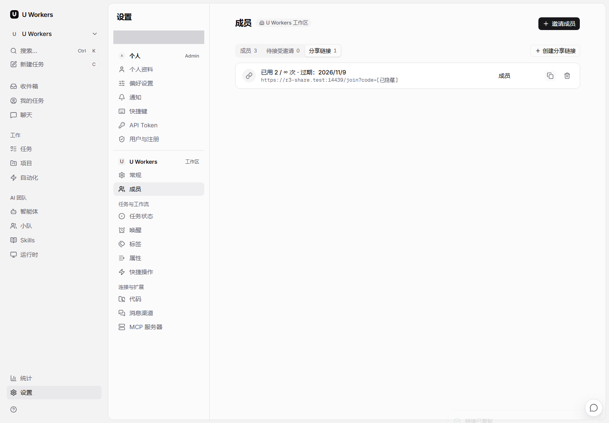
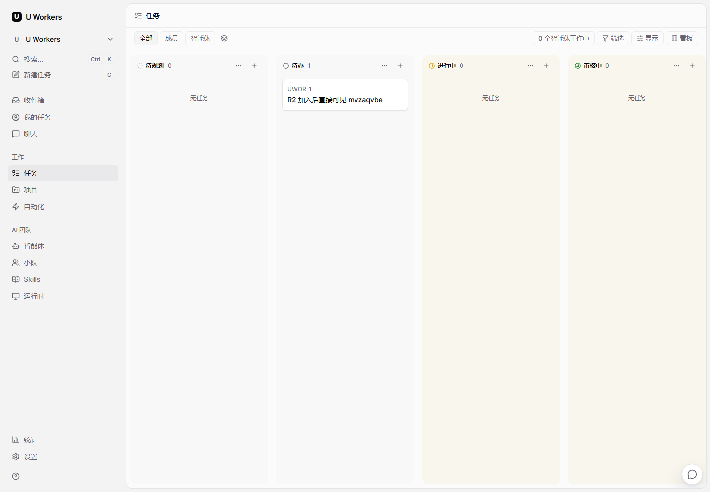

# CLAWSTA-118 R3 验证记录

2026-11-02。继续 PR #22，起点 `81c3570a0`，产品修复提交 `0c9407ab6`。R1/R2 的产品代码及历史证据保留。本批只提交 PR，不合并、不发版，不修改公司部署。

## 结果

- 从本机入口打开成员页，复制**已有**工作区分享链接，地址改用运行时配置的另一前端入口。通过另一入口登录后复制，得到完全相同的 URL；没有新建工作区邀请。
- 新同事通过账号邀请自行设密，再打开该工作区 URL，一次加入请求即进入正确任务看板，无须刷新。刷新后仍能访问。
- 数据库确认该账号仅有一条目标工作区的 `member` 关系，`is_instance_admin=false`、`onboarded=true`。已有链接的 code、角色、有效期、次数上限未变，`use_count` 只增加一次。开放注册保持关闭。
- 账号设密邀请的既有 `useAppOrigin` 也复用导航适配器，本次复制和设密流程使用了同一配置入口；未增加另一套 URL 来源。
- 用户已找到分享标签并成功加入，原“标签缺失待截图”事项关闭。教程补旧版从局域网入口复制**已有链接**的办法，以及仅替换同一部署协议、主机、端口并保留 `/join?code=...` 的边界。

## 地址契约与自动化

新增 `/api/config.public_app_url`，依次校验 `MULTICA_APP_URL`、`FRONTEND_ORIGIN`。只发布有效、非回环且无凭据的 HTTP(S) 前端 origin，排除未指定地址、无效端口及带路径/query/hash 的配置值。不使用 API URL、daemon 专用字段或构建期 `NEXT_PUBLIC` 常量。core schema 默认缺失/畸形值为空，config store 独立保存；web 导航订阅更新，复制回调在执行时读取最新值，原样拼接应用路径/query/hash。旧服务端、未加载或无可用地址时回退浏览器 origin；桌面适配器保持原行为。

| 检查 | 结果 |
| --- | --- |
| Go `go test -p 2 ./internal/handler/configpolicy -count=1` | 通过；新增公开字段、优先级、安全过滤及回退用例，原隐私配置测试也通过 |
| core `config/public-app-url.test.ts`、`api/schema.test.ts` | 2 文件、148 测试通过 |
| core `platform/auth-initializer.test.tsx` | 14 测试通过，包含配置应用及旧服务端清空旧值 |
| web `platform/navigation.test.tsx`、`app/join/page.test.tsx` | 2 文件、27 测试通过，包含晚到配置、旧回调读取新值、完整路径参数及 R2 加入回归 |
| views `members-tab.test.tsx`、`navigation/app-link.test.tsx` | 2 文件、39 测试通过 |
| views `instance-users-tab.test.tsx` | 12 测试通过；账号邀请组件既有回归 |
| desktop `platform/navigation.test.tsx` | 25 测试通过 |
| 受影响 core/web 文件 ESLint、core typecheck | 通过 |
| `scripts/native-windows.ps1 -Action Build` | Go API/migrate/local-auth 与完整 Next.js 生产构建、web TypeScript 通过 |
| 真实浏览器与数据库核对 | [13 项逐项结果](browser-checks.json) 全部通过 |

上述 TypeScript 用例共 265 项通过；`git diff --check`、相对链接和交付物凭据扫描通过，三张截图已逐一检查。R1/R2 证据目录与原安装、加入修复文件相对 `81c3570a0` 无差异。

构建保留原有两个 `::highlight` CSS 警告；webpack 缓存报告缺少旧 `0.pack`，编译、TypeScript、静态页及最终构建均成功。构建开始时 HEAD 为 `81c3570a0`，工作树含现已提交为 `0c9407ab6` 的 R3 产品代码；二进制版本戳沿用构建开始时 HEAD，实际候选件通过新 `public_app_url` 字段和浏览器行为核验。

本机内存紧张，初次 Vitest worker 启动超过固定 60 秒而未执行断言。仅在测试进程内临时延长框架的 worker 启动等待为 300/330 秒，未改依赖文件、项目配置、断言或用例超时。一次尝试关闭文件隔离导致 Testing Library 清理钩子失效，已撤销该参数；表中最终结果均使用默认文件隔离，且无未处理错误。Go 的旧 configpolicy 无数据库夹具，现补“无注册设置”的测试替身，产品注册逻辑未改。未重跑 R1/R2 全套、全量 Go DB 集成测试或完整 LAN 证书矩阵。

## 双入口实测方式

复用已停止的 R2 私有测试副本，数据库/API/web/HTTPS 端口分别为 `17439 / 18439 / 13439 / 14439`；换入本轮候选 API 和 standalone web。未启动 agent daemon、真实 agent 或邮件流程。

- 本机入口：`https://127.0.0.1:14439`。
- 配置入口：`https://r3-share.test:14439`。Chromium `host-resolver-rules` 将该测试域名映射至 `127.0.0.1`，同时在**本次浏览器**中绕过该域名及回环地址的既有代理。未改 OS hosts、系统代理、防火墙或根证书信任。
- 专用 Caddy 只监听回环；同一 API、数据库和网页服务提供两个入口。测试浏览器上下文忽略该私有证书的信任错误。这个方法验证了双入口的地址选择和完整加入，不代表公司网络的可达性或证书验收。
- 第一轮复制副本后漏恢复两条 app 级依赖链接，前端未启动；用已有 `Restore-PortableWebLinks` 补齐后继续。测试域名首轮被浏览器沿用的代理接管，补浏览器专用绕过规则后双入口都返回 200。均为测试准备修正，未改产品代码。
- 测试代理首次沿用默认 autosave 位置；已恢复此前 R2 的测试缓存，改用隔离配置目录并关闭 autosave，确认后续启动未改变该缓存。未重载任何现有服务。

截图先完成真实复制及完整 URL 相等断言，再仅将 capability code 替换成 `[已隐藏]`；输入框遮罩。未保存 Cookie、token、原始邀请 URL、HAR 或浏览器 trace 到交付物。

| 从本机页复制 | 从配置入口复制 | 加入目标工作区 |
| --- | --- | --- |
|  |  |  |

测试浏览器和数据库连接已关闭，专用 Caddy 与 native API/web/PostgreSQL 均已停止，四个测试端口确认释放。测试根保留数据供后续验收；无后台验证任务。
