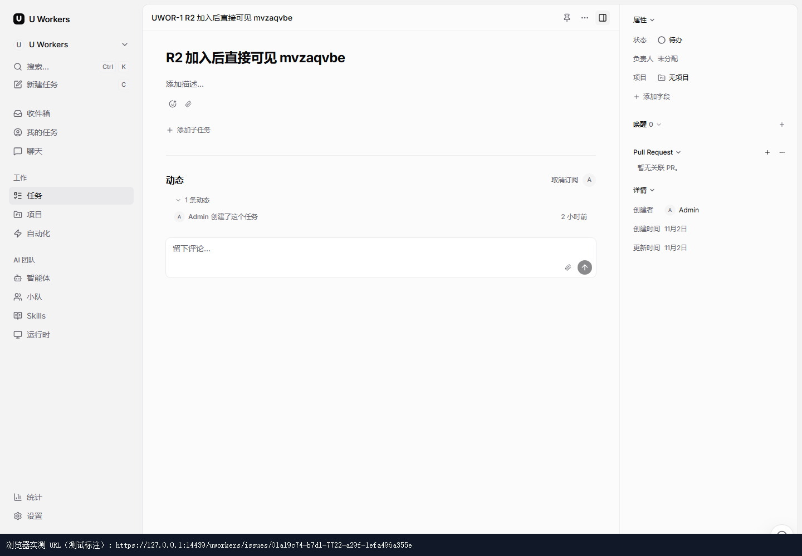
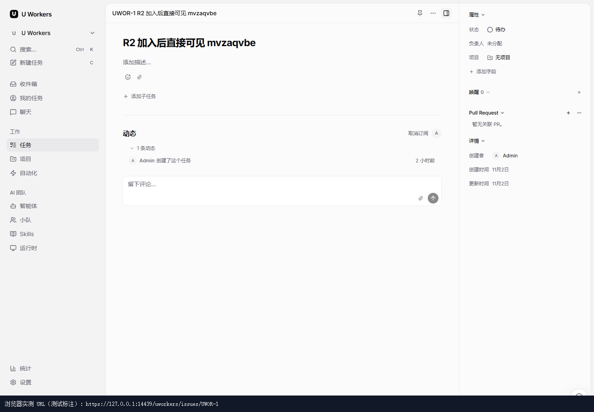
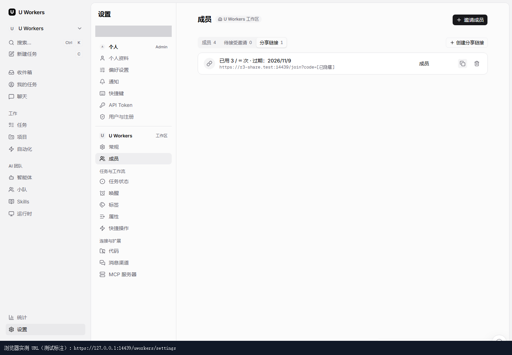

# CLAWSTA-118 R4 验证记录

继续 [PR #22](https://github.com/AndyTane/UWorkers-nice/pull/22)，起点 `d2863049f`，实现提交 `080b3883c`。本批关闭复制地址影响内部导航的回归；R2 前端与 R3 后端已有验收结论，留待负责人接收后仅复审 R4。

## 新增差异

| 用途 | 本批处理 |
| --- | --- |
| 网页内部导航、新标签 | `getShareableUrl` 恢复当前浏览器 origin，保留当前入口的会话 |
| 对外复制 | 新增必需的 `getExternalShareUrl`；优先有效运行时 `publicAppUrl`，否则当前 origin。保留 SSR 相对路径、配置晚到和原路径/query/hash/code |
| 复制调用点 | 成员分享、账号设密邀请、任务及评论、项目、搜索面板、反馈附带页面地址全部迁移；任务打开操作保持原导航出口 |
| 内容链接识别 | 保留单值 `useAppOrigin` 的类型；新增 `useAppOrigins`，编辑器、富文本、hover 预览接受当前/公开两个精确 URL origin；外站、相似前缀域名及不同端口仍为外链 |
| 桌面及预览 | 主窗口、任务独立窗口两出口均使用原 appUrl，独立窗口未就绪仍返回相对路径；UI Lab 同步实现契约 |
| 测试替身 | 新方法是显式必需契约，因此已有导航替身补字段；其他测试行为未扩展 |

`use-row-link`、`use-intent-navigate`、`chat-thread-list`、`attachment-preview-modal` 的新标签调用未机械改为复制出口。Go/core 配置校验与响应、安装权限、加入同步及 R1/R2/R3 历史证据相对起点完全不变。

## 自动化

| 检查 | 最终结果 |
| --- | --- |
| views 导航 hook、链接解析、成员、账号邀请 | 5 文件，70 测试通过 |
| views 富文本路由/unfurl、任务动作、项目、搜索、反馈、AppLink | 7 文件，104 测试通过；其中任务/项目/反馈三文件最终复跑 28 项通过 |
| web 适配器及实际 useRowLink 中键 wiring | 14 测试通过，包含配置晚到时识别 origin 的实际渲染更新 |
| desktop 主窗口及任务独立窗口 | 2 文件，32 测试通过 |
| views、desktop renderer、UI Lab typecheck | 通过 |
| 受影响 views/web/desktop/UI Lab lint | 通过；项目详情原有 useEffect 依赖警告，0 error |

合计 15 文件、220 项不同用例通过，保持默认文件隔离。沿用 R3 的测试进程专用启动等待延长器，仅延长 Vitest worker 启动 deadline；未改依赖文件、断言、用例超时或项目配置。修复前新增网页测试明确复现：中键目标为配置 origin 而非当前 origin；最终断言通过。

`pwsh -NoProfile -File scripts/native-windows.ps1 -Action Build -Root <隔离构建根>` 成功：Go API/migrate/local-auth、Next.js 生产编译、web TypeScript、19 个静态页及 standalone 输出完成，产物标记 `v0.2.1 (080b3883c)`。候选副本 API 的 SHA-256 与此构建一致。原有两条 `::highlight` CSS 警告及 webpack 旧缓存 ENOENT 未影响成功；未重跑已验收的安装/加入矩阵或后端契约测试。构建生成的 `next-env.d.ts` 路径变化已恢复，未纳入提交。

## 真实浏览器

Chromium 对生产候选件的 [14 项逐项检查](browser-checks.json) 全部通过：

- 本机入口登录后，Ctrl 点击真实任务行，新标签最终仍为 `https://127.0.0.1:14439/.../issues/...`，任务标题可见；`/api/me` 返回 200、与原页同一账号，无额外登录请求。
- 在同一任务的右键菜单点击“在新标签页打开”，新标签仍使用本机 origin、任务可见、账号相同。前一项覆盖原生相对 AppLink，后一项直接覆盖 `useIssueActions` → `getShareableUrl` → `window.open` 的回归路径，未用 mock 代替。
- 在本机任务页通过搜索面板复制任务链接，剪贴板使用配置的公开 origin，页面未跳转。
- 在本机成员页复制已有分享链接，剪贴板仍使用 `https://r3-share.test:14439/join?...`，原 code 和路径保持不变。前后数据库的全部分享链接 id/code/角色/有效期/次数上限/use_count 完全一致，没有新建或消费邀请。

| Ctrl 点击真实任务 | 任务菜单打开新标签 | 从本机成员页复制公开地址 |
| --- | --- | --- |
|  |  |  |

沿用 R2/R3 隔离测试副本，端口 `17439 / 18439 / 13439 / 14439`。本机入口 `https://127.0.0.1:14439`，公开配置入口 `https://r3-share.test:14439`。测试域名只在 Chromium 中映射至回环并绕过代理，私有 TLS 信任错误仅在测试上下文忽略；不改系统 hosts、代理、防火墙或证书信任。

截图底部深色条是测试添加的 URL 标注，取自当时 `page.url()`，用于让无浏览器工具栏的截图也能判断 origin；其余为实际页面。分享 code 在真实剪贴板断言后隐藏，所有输入框遮罩；未交付 Cookie、密码、token、原始 capability URL、HAR 或 trace。

浏览器上下文、数据库连接、专用 Caddy、native API/web/PostgreSQL 全部已关闭，四个端口确认释放。全程关闭 Caddy autosave、使用隔离配置目录；已有 Caddy autosave 的 SHA-256 前后相同。未合并、发版、修改公司部署、现有服务或系统网络/证书设置，未调用真实 agent 或邮件流程。`git diff --check`、相对链接、脱敏交付物检查通过；三张截图已逐一目视检查。
